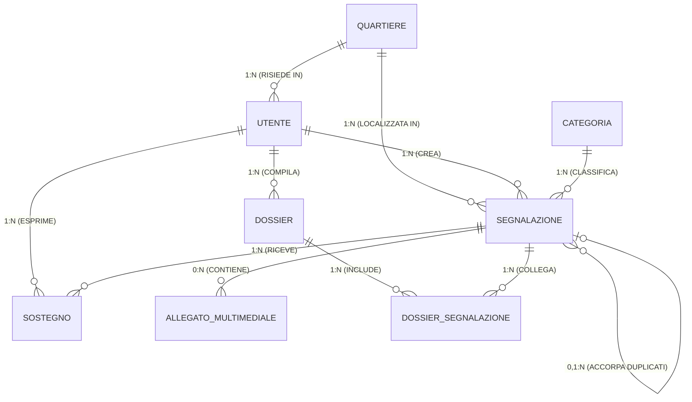

# Documentazione Schema Database: Gestione Segnalazioni e Dossier

---

## 1. Diagramma Entità-Relazioni (ER)

### Diagramma Visuale (Mermaid)



---

### Diagramma ASCII

```text
+---------------+ (1,1)               (0,N) +-------------------+ (0,N)               (1,1) +-------------------+
|   QUARTIERE   |---[ RISIEDE IN ]--------->|      UTENTE       |---[ COMPILA/CREA ]------>|      DOSSIER      |
+---------------+                           +-------------------+                           +-------------------+
  |                                           |                   |                                   |
  | (1,1)                                     | (1,1)             | (1,1)                             | (1,1)
  | [LOCALIZZATA IN]                          | [CREA]            | [ESPRIME]                         | [INCLUDE]
  v                                           v                   v                                   v
+-----------------------------------------------------------------------------------+               +-------------------+
|                                   SEGNALAZIONE                                    |               | DOSSIER_SEGNALAZ. |
+-----------------------------------------------------------------------------------+               +-------------------+
  ^ (0,N)                   ^ (0,N)           ^ (0,N)             | (1,1)                             ^ (0,N)
  |                         |                 |                   | [RICEVE]                          | [COLLEGA]
  | (1,1)                   | (1,1)           | (0,1)             v                                   |
  | [CLASSIFICA]            | [CONTIENE]      +-[ACCORPA DUPLIC.] +-------------------+               |
+---------------+         +-----------------------+               |     SOSTEGNO      |---------------+
|   CATEGORIA   |         | ALLEGATO_MULTIMEDIALE |               +-------------------+
+---------------+         +-----------------------+
```

---

## 2. Entità e Attributi

### 1. QUARTIERE
Rappresenta le zone o quartieri del territorio comunale.

| Attributo | Tipo / Vincolo | Descrizione |
| :--- | :--- | :--- |
| `ID_Quartiere` | **PK** | Identificativo univoco del quartiere. |
| `NomeQuartiere` | Non Nullo | Nome del quartiere (es. *Centro Storico*, *Quartiere Nord*). |
| `Cap_Zona` | Non nullo | Codice di riferimento della zona oppure CAP del territorio; il dato segnaposto iniziale è `00000`. |

---

### 2. UTENTE
Rappresenta gli utenti registrati alla piattaforma (cittadini, membri del comitato, amministratori).

| Attributo | Tipo / Vincolo | Descrizione |
| :--- | :--- | :--- |
| `ID_Utente` | **PK** | Identificativo univoco dell'utente. |
| `Nome` | Non Nullo | Nome dell'utente. |
| `Cognome` | Non Nullo | Cognome dell'utente. |
| `Email` | **UNIQUE**, Non Nullo | Indirizzo email per l'autenticazione. |
| `PasswordHash` | Non Nullo | Hash della password memorizzato in modo sicuro. |
| `TipoRuolo` | Enum | Ruolo dell'utente: `Cittadino`, `MembroComitato`, `Admin`. |
| `DataRegistrazione` | Timestamp | Data e ora di creazione dell'account. |
| `FK_Quartiere` | **FK** $\rightarrow$ `QUARTIERE` | Quartiere di residenza dell'utente. |

---

### 3. CATEGORIA
Tipologia di intervento o problema segnalato.

| Attributo | Tipo / Vincolo | Descrizione |
| :--- | :--- | :--- |
| `ID_Categoria` | **PK** | Identificativo univoco della categoria. |
| `NomeCategoria` | Non Nullo | Nome della categoria (es. *Buche Stradali*, *Illuminazione*, *Verde Pubblico*, *Movida*). |
| `Descrizione` | Testo | Breve descrizione dell'ambito della categoria. |

---

### 4. SEGNALAZIONE
Rappresenta la segnalazione di un disservizio o criticità inviata da un utente.

| Attributo | Tipo / Vincolo | Descrizione |
| :--- | :--- | :--- |
| `ID_Segnalazione` | **PK** | Identificativo univoco della segnalazione. |
| `Titolo` | Non Nullo | Titolo sintetico del problema. |
| `DescrizioneTestuale` | Testo | Dettaglio descrittivo del problema. |
| `Latitudine` | Decimal/Float | Coordinata geografica GPS. |
| `Longitudine` | Decimal/Float | Coordinata geografica GPS. |
| `Indirizzo` | Non Nullo | Indirizzo o localizzazione esatta del problema. |
| `DataCreazione` | Timestamp | Data e ora di invio della segnalazione. |
| `StatoAttuale` | Enum | Stato: `Inviata`, `Approvata`, `Presa in Carico`, `Inclusa nel Dossier`, `Risolta`. |
| `FK_Utente_Autore` | **FK** $\rightarrow$ `UTENTE` | Utente autore della segnalazione. |
| `FK_Categoria` | **FK** $\rightarrow$ `CATEGORIA` | Categoria di appartenenza della segnalazione. |
| `FK_Quartiere` | **FK** $\rightarrow$ `QUARTIERE` | Quartiere in cui si trova il problema. |
| `FK_SegnalazionePadre` | **FK** $\rightarrow$ `SEGNALAZIONE` *(Opzionale)* | Riferimento alla segnalazione principale in caso di merge/duplicato. |

> **Nota di Gestione Duplicati (Relazione Ricorsiva):**
> Il campo `FK_SegnalazionePadre` permette di accorpare più segnalazioni relative allo stesso identico evento/problema, collegandole a una segnalazione principale ("Padre").

---

### 5. ALLEGATO_MULTIMEDIALE
File multimediali (foto o video) caricati a supporto della segnalazione.

| Attributo | Tipo / Vincolo | Descrizione |
| :--- | :--- | :--- |
| `ID_Allegato` | **PK** | Identificativo univoco dell'allegato. |
| `UrlFile` | Non Nullo | Percorso o URL di salvataggio del file. |
| `TipoFile` | Enum | Tipologia di file: `Foto`, `Video`. |
| `DataUpload` | Timestamp | Data e ora dell'upload. |
| `FK_Segnalazione` | **FK** $\rightarrow$ `SEGNALAZIONE` | Segnalazione a cui è associato l'allegato. |

---

### 6. SOSTEGNO (VOTO)
Supporto/voto espresso dagli utenti nei confronti di una specifica segnalazione.

| Attributo | Tipo / Vincolo | Descrizione |
| :--- | :--- | :--- |
| `ID_Sostegno` | **PK** | Identificativo univoco del voto di sostegno. |
| `DataVoto` | Timestamp | Data e ora in cui è stato espresso il sostegno. |
| `FK_Utente` | **FK** $\rightarrow$ `UTENTE` | Utente che sostiene la segnalazione. |
| `FK_Segnalazione` | **FK** $\rightarrow$ `SEGNALAZIONE` | Segnalazione supportata. |

> **Vincolo d'Integrità:**
> È definito un vincolo d'univocità sulla coppia `(FK_Utente, FK_Segnalazione)`. Un utente può esprimere al massimo un solo voto di sostegno per ciascuna segnalazione.

---

### 7. DOSSIER
Raccolta organizzata di segnalazioni creata dai membri del comitato per la presentazione ad enti esterni o campagne specifiche.

| Attributo | Tipo / Vincolo | Descrizione |
| :--- | :--- | :--- |
| `ID_Dossier` | **PK** | Identificativo univoco del dossier. |
| `Titolo` | Non Nullo | Titolo del dossier (es. *Dossier Criticità Quartiere Sud - Elezioni 2026*). |
| `DataCreazione` | Timestamp | Data di creazione del dossier. |
| `NoteComitato` | Testo | Annotazioni o considerazioni elaborate dal comitato. |
| `FK_Utente_Creatore` | **FK** $\rightarrow$ `UTENTE` | Membro del comitato/Admin che ha creato il dossier. |

---

### 8. DOSSIER_SEGNALAZIONE
Tabella di giunzione per la relazione Molti-a-Molti ($N:M$) tra `DOSSIER` e `SEGNALAZIONE`.

| Attributo | Tipo / Vincolo | Descrizione |
| :--- | :--- | :--- |
| `FK_Dossier` | **PK**, **FK** $\rightarrow$ `DOSSIER` | Riferimento al dossier di destinazione. |
| `FK_Segnalazione` | **PK**, **FK** $\rightarrow$ `SEGNALAZIONE` | Riferimento alla segnalazione inclusa. |
| `DataInserimento` | Timestamp | Data in cui la segnalazione è stata aggiunta al dossier. |

> **Nota:**
> Consente l'inclusione di una singola segnalazione in più dossier distinti e, viceversa, di raccogliere più segnalazioni all'interno dello stesso dossier.

---

## 3. Riepilogo Cardinalità delle Relazioni

| Entità Origine | Relazione | Entità Destinazione | Cardinalità | Note |
| :--- | :--- | :--- | :--- | :--- |
| `QUARTIERE` | Residenza utenti | `UTENTE` | $1:N$ | Un utente appartiene a $1$ quartiere. |
| `QUARTIERE` | Ubicazione problemi | `SEGNALAZIONE` | $1:N$ | Una segnalazione si trova in $1$ quartiere. |
| `UTENTE` | Autoria segnalazioni | `SEGNALAZIONE` | $1:N$ | Una segnalazione è creata da $1$ utente. |
| `UTENTE` | Creazione dossier | `DOSSIER` | $1:N$ | Un dossier è redatto da $1$ utente. |
| `UTENTE` | Voto sostegno | `SOSTEGNO` | $1:N$ | Relazione gestita con vincolo UNIQUE su `(FK_Utente, FK_Segnalazione)`. |
| `CATEGORIA` | Classificazione | `SEGNALAZIONE` | $1:N$ | Ogni segnalazione ha $1$ categoria associata. |
| `SEGNALAZIONE` | Contenuto multimediale | `ALLEGATO_MULTIMEDIALE` | $0:N$ | Gli allegati sono facoltativi e ciascun allegato appartiene a una sola segnalazione. |
| `SEGNALAZIONE` | Merge duplicati | `SEGNALAZIONE` | $0,1:N$ | Relazione ricorsiva padre-figlio. |
| `DOSSIER` | Aggregazione | `SEGNALAZIONE` | $N:M$ | Realizzata tramite tabella di ponte `DOSSIER_SEGNALAZIONE`. |